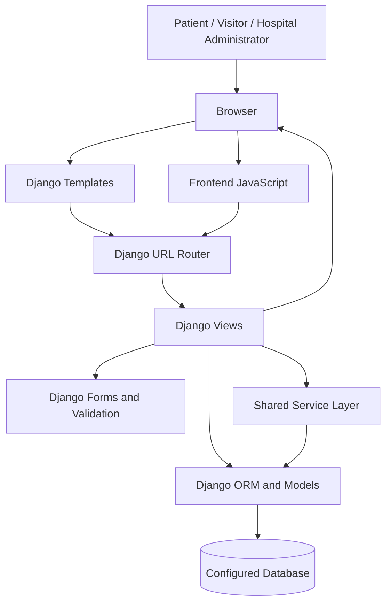
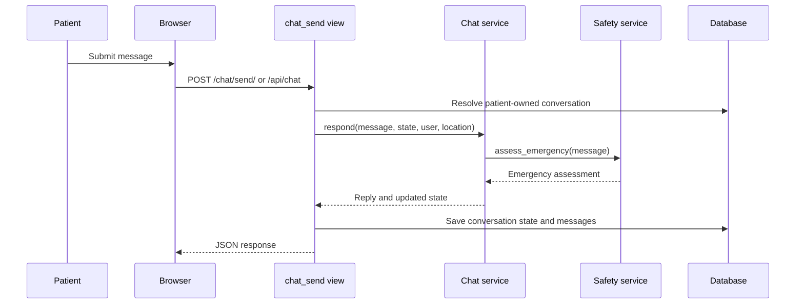
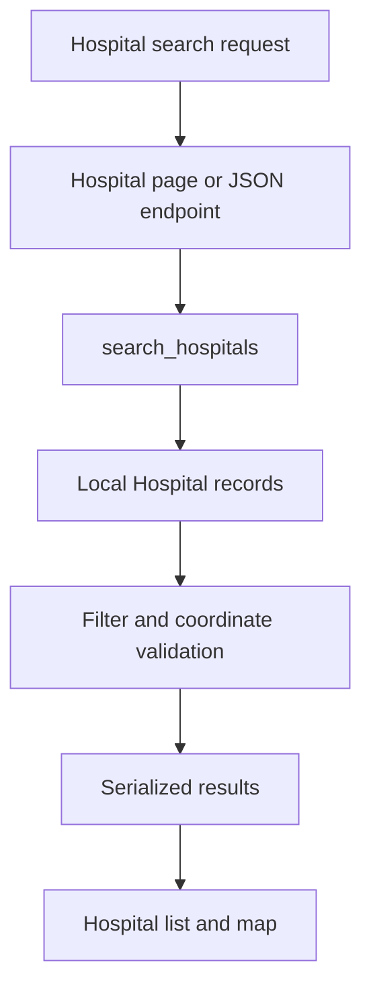
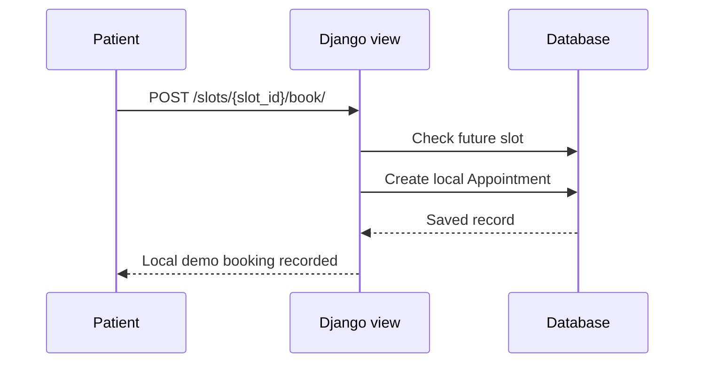
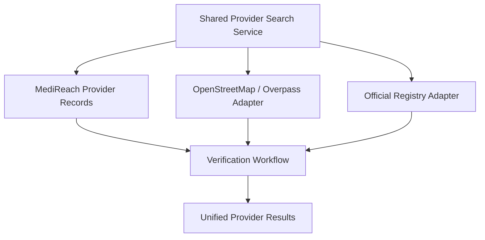

# MediReach — System Architecture

## 1. Document purpose

This document explains the architecture of the existing MediReach application.

It distinguishes:
- The architecture currently implemented in the Django project.
- The responsibilities of existing modules.
- The data flow between browser, views, services and models.
- Future architectural extensions that have been approved conceptually but are not yet implemented.

This is not a proposal to rewrite the application.

The existing Django architecture must be preserved and extended incrementally.

## 2. System overview

MediReach is a Django-based healthcare assistance and care-coordination application.

The current architecture is a server-rendered Django application with:
- Django views and URL routing.
- Django models and ORM.
- Django forms.
- Shared Python service modules.
- HTML templates.
- Browser-side JavaScript.
- JSON endpoints used by browser interactions.
- Leaflet and OpenStreetMap for the hospital map.

The current implementation includes user-triggered OpenStreetMap/Overpass facility discovery and an optional local Ollama adapter. Neither external directory data nor local model output is authoritative provider verification or clinical advice.

### 2.1 High-level architecture

## 3. Backend structure

### 3.1 Django project configuration

`config/`

Responsibilities:
- Django project settings.
- Root URL configuration.
- WSGI configuration.

`config/urls.py` includes:
- Django administration at `/admin/`.
- Application routes through `portal.urls`.

### 3.2 Main application

`portal/`

The portal application contains:
- Models.
- Forms.
- Views.
- URL declarations.
- Shared services.
- Chatbot logic.
- Management commands.
- Migrations.
- Tests.

### 3.3 Models

`portal/models.py`

Defines the current persistent domain entities:

- PatientProfile
- Doctor
- Hospital
- HospitalService
- HospitalAdministrator
- EmergencyContact
- EmergencyCase
- Referral
- HospitalEnquiry
- AuditLog
- ChatConversation
- AppointmentSlot
- Appointment
- ChatMessage
- MedicalNote
- Specialty
- DoctorSpecialty
- DoctorHospitalAffiliation
- ProviderSourceRecord
- ProviderVerification
- ProviderContact

Detailed field definitions and relationships are documented in DATABASE_SCHEMA.md.

### 3.4 Forms

`portal/forms.py`

The form layer handles input validation and model-backed forms.

Existing forms include:
- RegisterForm
- ProfileForm
- MedicalNoteForm
- ChatForm
- EmergencyContactForm
- HospitalEnquiryForm
- ReferralForm
- HospitalProfileForm
- HospitalServiceForm

Examples of existing validation:
- Duplicate email checks during registration.
- Email uniqueness when updating a profile.
- Hospital coordinate range validation.
- Model-form validation for contacts, notes, referrals and enquiries.

Views should use these existing forms where appropriate rather than duplicating validation.

### 3.5 Views

`portal/views.py`

Views coordinate:
- HTTP requests.
- Authentication and permissions.
- Form validation.
- Service calls.
- ORM operations.
- Template rendering.
- JSON responses.

Views should not become the location for duplicated business logic.

## 4. Shared service layer

The shared services are an important architectural boundary.

### 4.1 `portal/services/safety.py`

Responsible for deterministic emergency assessment.

Main public function:

`assess_emergency(message)`

The service:
- Detects configured emergency warning patterns.
- Handles negated statements.
- Considers historical and hypothetical context.
- Returns a structured emergency assessment.
- Provides a recommended emergency action when a warning sign is identified.

The service does not diagnose the patient.

Emergency handling must remain independent of any future LLM.

### 4.2 `portal/services/chat.py`

Main function:

`respond(message, state=None, user=None, latitude=None, longitude=None)`

Responsible for the existing rule-based assistant response flow.

The service contains intent handling for:
- First-aid categories.
- Hospital discovery.
- Hospital filters.
- Doctor discovery.
- Doctor specialties.
- Emergency priority.

It uses shared resource services rather than being the permanent owner of provider data retrieval.

### 4.3 `portal/services/resources.py`

Responsible for shared resource retrieval and transformations.

Existing functions include:

- `haversine_km`
- `_valid_coordinates`
- `resolve_manual_location`
- `_service_status`
- `serialize_hospital`
- `search_hospitals`
- `get_hospital_details`
- `search_doctors`
- `doctor_queryset`
- `doctors_for_hospital`
- `serialize_doctor`
- `discover_providers`
- `search_mapped_facilities`
- `retrieve_first_aid_guide`
- `get_emergency_contacts`
- `generate_emergency_summary`

This service is the shared boundary for MediReach-managed doctor/facility discovery and transient OSM results. Managed and OSM records have separate identifiers and trust labels. OSM results are not persisted and are not independently verified.

### 4.4 `portal/services/first_aid.py`

Contains curated first-aid guidance.

Existing function names:
- `get_first_aid_guide(category)`
- `list_first_aid_guides()`

The content includes source references, review dates and a medical-information disclaimer.

### 4.5 `portal/chatbot.py`

Contains an additional rule-based symptom conversation implementation.

It includes:
- Symptom detection.
- Negated symptom detection.
- Duration parsing.
- Temperature parsing.
- Temperature-related follow-up state.
- General guidance.
- Doctor recommendation and contact request handling.

Do not assume this module is identical to `portal/services/chat.py`.

Before modifying chatbot functionality, inspect both modules and their callers. Avoid creating a third competing chatbot implementation.

## 5. Frontend architecture

### 5.1 Django templates

The application uses templates under:

`templates/portal/`

Existing pages include:
- Home.
- Dashboard.
- Profile and form pages.
- Chatbot.
- Doctors and doctor detail.
- Hospitals and hospital detail.
- Appointments.
- Referrals.
- Enquiries.
- Emergency assistance.
- Emergency profile.
- Emergency summaries.
- First-aid pages.
- Patient history.
- Notes.
- Hospital-admin dashboard.

The base template provides shared navigation and layout.

### 5.2 JavaScript

`static/portal/`

Existing JavaScript includes:
- `chatbot.js`
- `hospital-finder.js`
- `navigation.js`

Responsibilities:
- Chat interactions.
- Hospital finder and map interaction.
- Browser navigation behaviour.

The backend remains the authority for authentication, permissions, validation and business decisions.

### 5.3 Hospital map

The hospital finder uses:
- Leaflet.
- The policy-compliant single-host OpenStreetMap raster tile URL, per-layer `strict-origin-when-cross-origin` referrer policy, and linked visible attribution. Leaflet 1.9.4 otherwise defaults tile `referrerPolicy` to false.
- Managed hospital coordinates and optional, user-triggered nearby Overpass searches.
- User-submitted area/city/PIN lookups through the replaceable `MEDIREACH_GEOCODER_URL` setting (defaults to public Nominatim; no autocomplete).

Overpass requests are bounded and cached in process. Its HTTP rate-limit, timeout and unavailable responses are reported separately from geocoder errors; coordinates are not exposed in those messages. Location lookup has a 10-second timeout, result and negative-result caching, rate-limit cooldown, an application User-Agent, and a one-request-per-second limit across workers sharing a host. Cross-host rate coordination is not provided. Public-service availability and production rate behavior require runtime verification.

The map must:
- Validate coordinates.
- Preserve OpenStreetMap attribution.
- Have a useful list fallback.
- Avoid claiming that a mapped facility is credential-verified.
- Handle external tile failures gracefully.

Browser rendering and external tile loading remain pending verification. The map reports selected tile provider, Leaflet load state, tile state, location lookup state and source-result counts, and retains a visible facility list if Leaflet or the tile service fails.

## 6. Authentication and access boundaries

### 6.1 Patient access

The application uses Django authentication.

Patient-owned views use `login_required` where required.

Patient data should be retrieved through the authenticated user's relationships or explicit ownership filters.

Examples:
- `request.user.chat_messages`
- `request.user.chat_conversations`
- `request.user.appointments`
- `request.user.medical_notes`
- `request.user.emergency_contacts`
- `request.user.referrals`
- `request.user.hospital_enquiries`
- `request.user.emergency_cases`

### 6.2 Hospital administrators

Hospital administrator access is represented by `HospitalAdministrator`.

The `hospital_admin_required` decorator:
- Requires login.
- Checks for a HospitalAdministrator profile.
- Rejects access when no profile exists.

Administrative operations must be scoped to the hospital assigned to that administrator.

### 6.3 Anonymous access

Some discovery pages and the hospital enquiry form are accessible without login.

Anonymous enquiries have no patient account association and cannot be tracked through the patient account.

Do not assume every JSON endpoint is public or every page is private. Consult API_REFERENCE.md.

## 7. Existing workflow architecture

### 7.1 Chat workflow

The actual response format is determined by `portal/services/chat.py` and should be documented from its implementation.

The browser must not bypass emergency assessment.

### 7.2 Hospital discovery

The current search uses local application data.

User-triggered OpenStreetMap/Overpass discovery is implemented in `portal/services/osm_facilities.py`. ABDM HFR and professional-registry integrations are not implemented and require separate access approval.

### 7.3 Doctor discovery

The doctor directory uses `doctor_queryset`.

Doctor JSON results use `search_doctors`.

Doctor detail pages display future slots that are not already actively booked.

### 7.4 Appointment workflow

No provider is contacted by this workflow.

The database record must not be described as a confirmed external appointment.

### 7.5 Referral and enquiry workflow

Referral:
- Patient submits a referral form.
- A local Referral record is created.
- Patient can view their own referrals.
- Hospital administrators can view referrals associated with their hospital and update status.

Enquiry:
- Patient or anonymous visitor submits an enquiry.
- A local HospitalEnquiry record is created.
- Hospital administrators can view enquiries associated with their hospital and update status.
- Anonymous submitters cannot track the enquiry through an account.

Neither workflow proves external delivery.

## 8. Existing database architecture

The project uses Django ORM models.

The configured database engine is determined by `config/settings.py`.

SQLite is the current local-development baseline.

The project must remain compatible with future PostgreSQL use.

No database schema change is authorised by this architecture document.

## 9. Future architecture — planned, not implemented

The following are approved future directions.

### 9.1 Provider source adapters

Planned architecture:

This is a target design, not the current implementation.

### 9.2 Local AI

The current assistant can optionally call a locally configured Ollama model for general fallback questions. Deterministic emergency rules and structured flows take precedence, and unsafe/unavailable model output falls back to deterministic guidance.

The model must not:
- Decide emergency priority.
- Diagnose.
- Prescribe.
- Invent provider information.
- Confirm appointments.
- Claim notifications were delivered.

The deterministic application services remain authoritative.

### 9.3 Notifications

A future notification service may support real provider or patient communication.

Until implemented and verified, local records must not be described as sent or delivered.

## 10. Architecture rules for contributors

1. Preserve the existing Django application.
2. Reuse shared services.
3. Keep emergency assessment deterministic.
4. Do not duplicate provider search.
5. Keep patient ownership checks in backend queries.
6. Keep hospital-admin queries hospital-scoped.
7. Keep templates focused on presentation.
8. Keep browser JavaScript away from security-critical decisions.
9. Document new endpoints and models.
10. Update the master plan after each reviewed phase.

---
