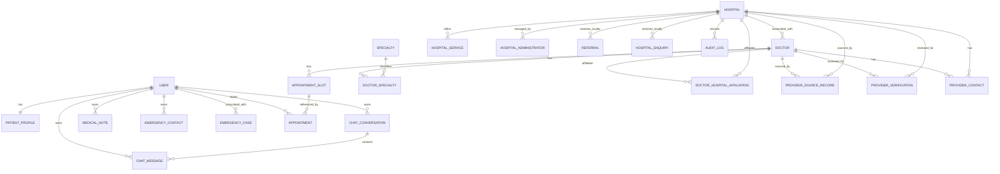

# MediReach — Database Schema Reference

## 1. Purpose

This document describes the Django models declared in `portal/models.py` and the migration history in `portal/migrations/`.

It documents the declared schema, not the contents or current migration state of any database file.

No database was queried to prepare this document.

## 2. Database engine

The project settings define the database configuration.

SQLite is the local-development baseline.

The application should preserve compatibility with PostgreSQL for future deployment.

The current database incident is documented in the project master plan.

Do not run migrations, seed commands, resets or direct SQL changes without the required approval and backup procedure.

## 3. Model inventory

The current `portal` application declares 21 models:

1. PatientProfile
2. Doctor
3. Hospital
4. HospitalService
5. HospitalAdministrator
6. EmergencyContact
7. EmergencyCase
8. Referral
9. HospitalEnquiry
10. AuditLog
11. ChatConversation
12. AppointmentSlot
13. Appointment
14. ChatMessage
15. MedicalNote
16. Specialty
17. ProviderSourceRecord
18. DoctorSpecialty
19. DoctorHospitalAffiliation
20. ProviderVerification
21. ProviderContact

All models use Django's automatically generated primary key unless otherwise configured.

## 4. Detailed model definitions

### 4.1 PatientProfile

Purpose: stores patient-specific profile information associated with a Django user.

Fields:

| Field | Type | Null/blank | Notes |
|---|---|---|---|
| user | OneToOneField to AUTH_USER_MODEL | Required | CASCADE; related_name `profile` |
| age | PositiveSmallIntegerField | Nullable, blank | Optional age |
| gender | CharField(30) | Blank | |
| phone | CharField(30) | Blank | |
| health_information | TextField | Blank | Patient-provided health information |

Relationship:
- One user has at most one PatientProfile.
- Deleting the user cascades to the profile.

### 4.2 Doctor

Purpose: stores doctor directory records.

Fields:

| Field | Type | Null/blank | Notes |
|---|---|---|---|
| name | CharField(120) | Required | |
| specialization | CharField(100) | Required | |
| experience | PositiveSmallIntegerField | Required | Default 0 |
| qualification | CharField(120) | Required | |
| fee | DecimalField(8,2) | Nullable, blank | |
| bio | TextField | Blank | |
| hospital | ForeignKey to Hospital | Nullable, blank | SET_NULL; related_name `doctors` |
| contact_route | CharField(240) | Blank | Directory URL or hospital contact route |
| verification_status | CharField(24) | Required | Default `demo` |
| registration_number | CharField(128) | Blank | Default empty; no automatic verification |
| professional_status | CharField(12) | Required | `active`, `inactive`, or `unknown`; default `unknown` |
| specialties | ManyToManyField through DoctorSpecialty | Blank | Structured specialty links |
| facilities | ManyToManyField through DoctorHospitalAffiliation | Blank | Current and historical affiliations |

Verification choices:
- demo
- confirmed
- verified
- unknown
- expired

Important:
- Doctor records may be fictional demo records.
- The presence of qualification text is not proof of credential verification.
- `contact_route` must not contain unverified phone numbers.
- `hospital` remains the legacy relationship; `specialization` remains the legacy free-text field.
- Current affiliations must be selected using `is_current=True`; historical rows remain stored.

### 4.3 Hospital

Purpose: stores healthcare facility directory records.

Fields:

| Field | Type | Null/blank | Notes |
|---|---|---|---|
| name | CharField(180) | Required | |
| city | CharField(100) | Required | |
| address | CharField(300) | Required | |
| latitude | DecimalField(9,6) | Nullable, blank | |
| longitude | DecimalField(9,6) | Nullable, blank | |
| phone | CharField(40) | Blank | Only verified public number |
| website | URLField | Blank | |
| verification_status | CharField(24) | Required | Default `demo` |
| verification_expires_at | DateTimeField | Nullable, blank | |
| is_demo | BooleanField | Required | Default True |
| updated_at | DateTimeField | Required | auto_now |
| created_at | DateTimeField | Required | auto_now_add |
| facility_type | CharField(24) | Nullable, blank | Hospital, clinic, diagnostic/imaging centre, pharmacy, or other |
| operational_status | CharField(24) | Required | Operational, temporarily/permanently closed, or unknown; default `unknown` |

Ordering:
- city
- name

Verification choices:
- demo
- confirmed
- verified
- unknown
- expired

Property:
`effective_verification_status`

Behaviour:
- Returns `expired` if verification expiry is in the past.
- Returns `demo` if `is_demo` is true.
- Otherwise returns the stored verification status.

Relationships:
- One Hospital may have multiple doctors.
- One Hospital may have multiple services.
- One Hospital may have multiple administrators.
- One Hospital may have multiple referrals and enquiries.
- One Hospital may have multiple audit events.
- One Hospital may have provider source records, verification records, provider contacts, and doctor affiliations.

### 4.4 HospitalService

Purpose: represents a service or facility capability reported for a hospital.

Fields:

| Field | Type | Null/blank | Notes |
|---|---|---|---|
| hospital | ForeignKey to Hospital | Required | CASCADE; related_name `services` |
| service_type | CharField(20) | Required | |
| specialty_name | CharField(100) | Blank | |
| status | CharField(20) | Required | Default `unknown` |
| details | CharField(300) | Blank | |
| source | CharField(240) | Required | Default says demo data is not confirmed |
| updated_at | DateTimeField | Required | auto_now |
| expires_at | DateTimeField | Nullable, blank | |
| updated_by | ForeignKey to AUTH_USER_MODEL | Nullable, blank | SET_NULL |

Service types:
- emergency
- icu
- trauma
- specialty

Stored status choices:
- available
- unavailable
- unknown

Property:
`effective_status`

Behaviour:
- Returns `unknown` when expiry has passed.
- Otherwise returns stored status.

Constraint:
`unique_hospital_service_item`

Unique fields:
- hospital
- service_type
- specialty_name

### 4.5 HospitalAdministrator

Purpose: associates an authenticated user with a hospital administration profile.

Fields:
- user: OneToOneField to AUTH_USER_MODEL, CASCADE, related_name `hospital_admin_profile`.
- hospital: ForeignKey to Hospital, CASCADE, related_name `administrators`.
- created_at: DateTimeField, auto_now_add.

One user can have one HospitalAdministrator profile.

A hospital may have multiple administrator profiles.

### 4.6 EmergencyContact

Purpose: stores a patient's emergency contact information.

Fields:
- user: ForeignKey to AUTH_USER_MODEL, CASCADE, related_name `emergency_contacts`.
- name: CharField(120).
- phone: CharField(40).
- relationship: CharField(80), blank.
- created_at: DateTimeField, auto_now_add.

Ordering:
- created_at

Stored contact information does not imply that the contact is automatically notified during an emergency.

### 4.7 EmergencyCase

Purpose: stores an emergency summary when the user explicitly requests saving it.

Fields:
- user: ForeignKey to AUTH_USER_MODEL, SET_NULL, nullable and blank, related_name `emergency_cases`.
- reported_facts: JSONField, default dict.
- location_shared: BooleanField, default False.
- latitude: DecimalField(9,6), nullable and blank.
- longitude: DecimalField(9,6), nullable and blank.
- created_at: DateTimeField, auto_now_add.

The user may be null.

Location is stored only when the relevant location consent and valid coordinates are supplied through the emergency summary workflow.

### 4.8 Referral

Purpose: stores a local referral request associated with a hospital.

Fields:
- patient: ForeignKey to AUTH_USER_MODEL, SET_NULL, nullable and blank, related_name `referrals`.
- hospital: ForeignKey to Hospital, CASCADE, related_name `referrals`.
- summary: CharField(1000).
- status: CharField(24), default `received`.
- created_at: DateTimeField, auto_now_add.
- updated_at: DateTimeField, auto_now.

Status choices:
- received
- reviewing
- information_requested
- acknowledged
- closed

A local Referral record does not prove external delivery or acceptance.

### 4.9 HospitalEnquiry

Purpose: stores an enquiry submitted to a hospital within MediReach.

Fields:
- patient: ForeignKey to AUTH_USER_MODEL, SET_NULL, nullable and blank, related_name `hospital_enquiries`.
- hospital: ForeignKey to Hospital, CASCADE, related_name `enquiries`.
- message: CharField(1000).
- status: CharField(24), default `received`.
- created_at: DateTimeField, auto_now_add.
- updated_at: DateTimeField, auto_now.

Status choices are the same as Referral.

Anonymous enquiries have a null patient.

A local enquiry record does not prove that the hospital received it.

### 4.10 AuditLog

Purpose: stores hospital administrative activity.

Fields:
- administrator: ForeignKey to AUTH_USER_MODEL, SET_NULL, nullable, related_name `hospital_audit_events`.
- hospital: ForeignKey to Hospital, CASCADE, related_name `audit_events`.
- action: CharField(120).
- details: JSONField, default dict, blank.
- created_at: DateTimeField, auto_now_add.

### 4.11 ChatConversation

Purpose: stores an individual patient's chat thread and rule-based context.

Fields:
- patient: ForeignKey to AUTH_USER_MODEL, CASCADE, related_name `chat_conversations`.
- state: JSONField, default dict, blank.
- created_at: DateTimeField, auto_now_add.
- updated_at: DateTimeField, auto_now.

Ordering:
- newest updated first.

A conversation belongs to one patient.

### 4.12 AppointmentSlot

Purpose: represents a doctor-associated local appointment slot.

Fields:
- doctor: ForeignKey to Doctor, CASCADE, related_name `slots`.
- starts_at: DateTimeField.

Ordering:
- starts_at ascending.

Constraint:
`unique_doctor_slot`

Unique fields:
- doctor
- starts_at

### 4.13 Appointment

Purpose: records a patient's local booking against an appointment slot.

Fields:
- patient: ForeignKey to AUTH_USER_MODEL, CASCADE, related_name `appointments`.
- slot: ForeignKey to AppointmentSlot, PROTECT, related_name `appointments`.
- status: CharField(12), default `booked`.
- created_at: DateTimeField, auto_now_add.

Status choices:
- booked
- cancelled
- completed

Constraint:
`unique_active_slot_booking`

This is a conditional unique constraint allowing at most one appointment with status `booked` per slot.

Ordering:
- newest slot start first.

Important:
A local Appointment is not a provider-confirmed appointment.

### 4.14 ChatMessage

Purpose: stores a patient's message or assistant response.

Fields:
- patient: ForeignKey to AUTH_USER_MODEL, CASCADE, related_name `chat_messages`.
- conversation: ForeignKey to ChatConversation, CASCADE, nullable and blank, related_name `messages`.
- role: CharField(10), choices `user` and `bot`.
- content: TextField(max_length=2000).
- created_at: DateTimeField, auto_now_add.

Ordering:
- created_at ascending.

The nullable conversation relationship allows messages without an associated conversation.

The current migrations do not show a data migration assigning older messages to conversations.

### 4.15 MedicalNote

Purpose: stores patient-owned notes.

Fields:
- patient: ForeignKey to AUTH_USER_MODEL, CASCADE, related_name `medical_notes`.
- title: CharField(120).
- body: TextField(max_length=5000).
- created_at: DateTimeField, auto_now_add.

Ordering:
- newest first.

### 4.16 Specialty

Stores a structured specialty label with a unique slug, optional description, active flag, and created/updated timestamps. Ordered by name; indexed by `(is_active, name)`.

### 4.17 ProviderSourceRecord

Stores source provenance for exactly one Doctor or Hospital. Fields include source type, optional external identifier, source name/URL, retrieved/source-updated/last-seen timestamps, JSON metadata, optional submitting user, and timestamps.

Constraints:
- A database check requires exactly one of `doctor` or `hospital`.
- `(source_type, source_name, external_id)` is conditionally unique when `external_id` is non-empty.

Doctor and hospital owners use `PROTECT`; deleting the submitting user sets `submitted_by` to null. Model validation also enforces the owner XOR rule.

### 4.18 DoctorSpecialty

Joins Doctor to Specialty, with `is_primary`, optional source record, and timestamps. The `(doctor, specialty)` pair is unique; a conditional unique constraint allows at most one primary specialty per doctor. The specialty is protected from deletion; deleting a doctor cascades; deleting a source record sets the link's source to null. `clean()` requires any source record to belong to the same doctor.

### 4.19 DoctorHospitalAffiliation

Joins Doctor to Hospital and preserves historical records through `is_current`, `valid_from`, and `valid_until`. It also stores relationship type, `is_primary`, optional source record, and timestamps.

Constraints and validation:
- At most one current row for a doctor/facility pair.
- At most one current primary facility per doctor.
- `valid_until` cannot precede `valid_from` when both are set.
- Model validation disallows a historical primary affiliation and requires a source record to belong to either the same doctor or the same hospital.

Doctor and hospital deletion are protected; deleting a source record sets the affiliation source to null.

### 4.20 ProviderVerification

Stores a verification decision for exactly one Doctor or Hospital, including verification type, status, source type, evidence reference, reviewer, verification and expiry timestamps, review notes, and audit timestamps. Database constraints enforce the owner XOR and require evidence, reviewer, and verification time for a `verified` status.

The current model `save()` rejects verified decisions because an authorized MediReach reviewer permission is not configured. Do not treat the presence of a source record as verification.

### 4.21 ProviderContact

Stores a contact for exactly one Doctor or Hospital, including contact type/value, primary flag, independent contact verification status/evidence/reviewer/time, optional source record, and timestamps. Constraints enforce owner XOR, required evidence for verified contacts, and at most one primary contact per owner and contact type.

Contact verification is independent of provider verification. The source record must belong to the same owner according to model validation. Doctor/hospital, source-record, and reviewer deletion are protected.

## 5. Relationship overview

The diagram represents the conceptual relationships in the models. The actual database constraints are defined in model fields and migrations.

## 6. Deletion behaviour

Important on-delete rules:

| Relationship | Behaviour |
|---|---|
| PatientProfile.user | CASCADE |
| Doctor.hospital | SET_NULL |
| HospitalService.hospital | CASCADE |
| HospitalAdministrator.user | CASCADE |
| HospitalAdministrator.hospital | CASCADE |
| EmergencyContact.user | CASCADE |
| EmergencyCase.user | SET_NULL |
| Referral.patient | SET_NULL |
| Referral.hospital | CASCADE |
| HospitalEnquiry.patient | SET_NULL |
| HospitalEnquiry.hospital | CASCADE |
| AuditLog.administrator | SET_NULL |
| AuditLog.hospital | CASCADE |
| ChatConversation.patient | CASCADE |
| AppointmentSlot.doctor | CASCADE |
| Appointment.patient | CASCADE |
| Appointment.slot | PROTECT |
| ChatMessage.patient | CASCADE |
| ChatMessage.conversation | CASCADE |
| MedicalNote.patient | CASCADE |
| ProviderSourceRecord.doctor / hospital | PROTECT |
| ProviderSourceRecord.submitted_by | SET_NULL |
| DoctorSpecialty.doctor | CASCADE |
| DoctorSpecialty.specialty | PROTECT |
| DoctorSpecialty.source_record | SET_NULL |
| DoctorHospitalAffiliation.doctor / hospital | PROTECT |
| DoctorHospitalAffiliation.source_record | SET_NULL |
| ProviderVerification.doctor / hospital / verified_by | PROTECT |
| ProviderContact.doctor / hospital / source_record / verified_by | PROTECT |

## 7. Migration history

The source contains four migrations.

### 0001_initial

Creates the initial application schema, including:
- PatientProfile.
- Doctor.
- AppointmentSlot.
- Appointment.
- ChatMessage.
- MedicalNote.

It also creates:
- Unique doctor/start-time slot constraint.
- Conditional unique active appointment constraint.

### 0002_chatconversation_chatmessage_conversation

Creates ChatConversation.

Adds a nullable, optional conversation foreign key to ChatMessage.

No data migration is present in this migration to assign historical messages to conversations.

### 0003_hospital_doctor_contact_route_and_more

Adds or creates:
- Hospital.
- Doctor hospital relationship.
- Doctor contact route.
- Doctor verification status.
- EmergencyCase.
- EmergencyContact.
- AuditLog.
- HospitalAdministrator.
- HospitalEnquiry.
- Referral.
- HospitalService.
- Hospital service uniqueness constraint.
- Hospital verification and location fields.

### 0004_provider_data_foundation

Adds Doctor registration/professional-status fields and Specialty/Facility relationships; adds Hospital facility type and operational status; creates Specialty, DoctorSpecialty, DoctorHospitalAffiliation, ProviderSourceRecord, ProviderVerification, and ProviderContact with their indexes and constraints. It is additive and contains no data migration.

The migration source was found to contain a Python syntax error in the affiliation date constraint and was corrected during P6. It has not been imported, executed, or validated against any database. Backend and actual-database compatibility remain unverified.

## 8. Data integrity and security considerations

### Patient ownership

Patient-specific data must be queried through the authenticated user or filtered by the user's ID.

Do not trust client-supplied patient identifiers.

### Hospital administration

Hospital-admin actions must filter by the hospital assigned to the administrator.

### Appointment integrity

Preserve both slot uniqueness and active-booking uniqueness.

### Provider verification

Do not interpret a doctor's qualification text or hospital address as proof of verification.

### Service availability

Hospital service status may expire. Use the effective status rather than assuming the stored status remains current.

## 9. Further provider data work — not implemented

The current schema provides source records, verification records, contact records, specialty links, and affiliation history. It does not implement external registry synchronization, automated verification, a reviewer-permission system, data freshness jobs, or reliable cross-source duplicate detection. Do not infer these workflows from the presence of schema fields.

## 10. Database safety notice

A previous `migrate` and `seed_demo` operation ran against the project's existing database.

The operation reported four fictional doctors and 168 new slots created.

The database was not inspected or restored afterward.

Treat the project database as modified.

This document was created from source files only. No database was queried.

Do not run migration, seed, reset, cleanup or restore commands without an approved backup and recovery plan.

---
